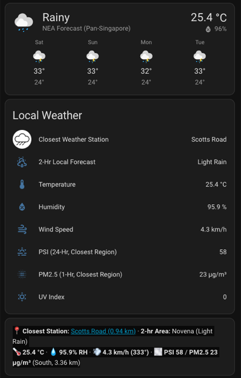

# NEA Singapore Weather Integration for Home Assistant

[CHANGELOG](CHANGELOG.md)

Home Assistant Integration to get current weather information directly from Data.gov.sg weather API published by Singapore National Environment Agency (SG NEA)

## Installation

Install this integration via **Home Assistant Marketplace** (Home Assistant 2026.11+) or **HACS**, or manually copy everything in `custom_components/nea_sg_weather` into the `custom_components/nea_sg_weather` directory inside your Home Assistant configuration folder (`/config/custom_components/nea_sg_weather` or `/homeassistant/custom_components/nea_sg_weather`).

Requires Home Assistant 2026.9 or newer.

Follow the integration config flow (**Settings → Devices & services → Add integration → NEA Singapore Weather**) to set up the following entities:
- `weather`: primary weather entity with 4-day daily forecasts. Temperature, humidity, wind, and current 2-hour condition are resolved automatically from the **closest active NEA weather station and forecast area** to your Home Assistant's configured home coordinates (`Settings → System → General`), with island-wide fallback if coordinates are not set.
- `closest` sensor (`sensor.<prefix>_closest`): selected by default in the sensor setup flow to avoid creating all 47 town sensors. Carries the **name of the closest active NEA weather station** as its state, along with `latitude`, `longitude`, `distance_km`, `forecast_area`, `forecast`, `temperature`, `humidity`, `wind_speed_kmh`, `wind_bearing`, and a direct `google_maps_url` link to the station's position, plus a paired `sensor.<prefix>_closest_psi` entity exposing 24-hour PSI and 1-hour PM2.5 for the closest NEA region.

  

- `area` (town) sensors: current weather conditions for specific areas/towns (or all 47 areas if `"All"` is explicitly selected) in Singapore.
- `region` sensors: 24 hour weather condition forecast for North/South/East/West/Central regions of Singapore
- `rain` camera: 2 camera entities for static and animated rain map overlays updated every 5 minutes from NEA
- `rain` sensors: one rainfall sensor per active NEA station, fetched live from the API — stations are added and removed automatically as the API changes
- `pm25` sensors: 5 pm2.5 sensors for North/South/East/West/Central regions of Singapore
- `psi` sensors: 5 sensors with the 24-hour PSI for North/South/East/West/Central regions of Singapore; the 24-hour PM2.5 and the per-pollutant sub-indices are exposed as attributes
- pollutant sensors: per region, the concentrations behind the PSI — PM2.5 and PM10 (24-hour), SO2 (24-hour), O3 and CO (8-hour max) and NO2 (1-hour max). These 30 sensors are created disabled; enable the ones you want from the region's device page
- `uv_index` sensor: UV index for Singapore

### Changing the configuration

To change which entities an instance sets up (weather entity, areas, region sensors, rain map and sensors, scan interval or timeout), open the integration's menu and choose **Reconfigure**; there is no need to remove and re-add it. The name and sensor prefix cannot be changed there, so existing entity IDs stay the same. Entities you switch off are removed when the integration reloads, and those you keep keep their settings.

### Devices and entity names

Each configured instance creates a device named after the instance (e.g. "Singapore Weather") holding the weather entity, the UV, area and rainfall sensors and the rain map cameras. When region sensors are enabled, each region gets its own device ("Central Singapore", "Northern Singapore", …) under the main device, holding that region's forecast, PM2.5 and PSI sensors.

Entity names follow Home Assistant's convention of device name plus entity name, e.g. "Singapore Weather UV index" or "Central Singapore PSI (24-hour)". Entity IDs are built from the configured prefix and do not depend on these names.

## Weather Map Overlays

Several `yaml` files are included to help you quickly set up a weather map card on Lovelace UI.

For the overlays to display properly, you will need the `area`, `region` and `rain` entities activated in the config flow (or switched on later with **Reconfigure**).

Besides the rain map and the town and region weather icons, the card can show NEA's own map overlays from the [rain areas page](https://www.nea.gov.sg/weather/rain-areas) — landmarks, townships, MRT stations and expressways — each with its own toggle, and NEA's rain intensity legend below the map.

1. `input_boolean.yaml`: to set up `input_boolean` toggles for the map overlays
2. `automations.yaml`: automations to manage how the map toggles work
3. `lovelace.yaml`: preset card config to display the weather map card

Instructions for how to integrate the `yaml` files are included in the various files in the `nea_sg_weather/yaml` folder.

## Rainfall sensors

Rainfall sensors are created dynamically from the live NEA API — no static station list is used. Orphaned sensors (stations decommissioned by NEA) are automatically removed from Home Assistant on startup and whenever the station list changes at runtime.

Sensors include location attributes so they can be displayed on a Lovelace map card.

For entity pictures to display correctly, copy all image files in `www/weather/` to your `config/www/weather/` folder.

